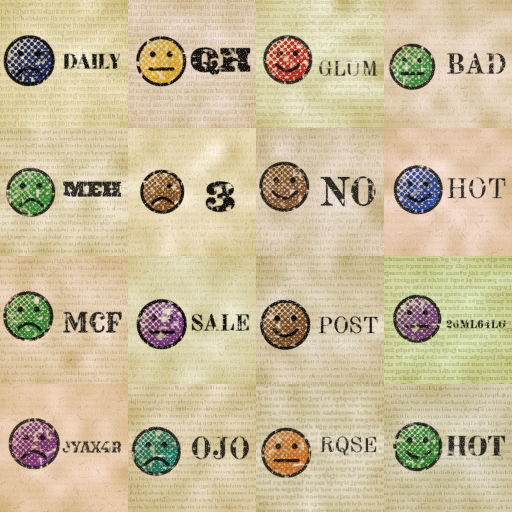

# grinpress 🗞️🙂

*Hot off the press: tiny inky faces, freshly generated.*

grinpress is a small text-to-image rectified-flow model (~34M params, pixel-space U-Net). It learns to
print vintage-newspaper halftone faces from a prompt like:

```
a red smiley face with 'HELLO' next to it
```

You get 12 ink colors, three moods (`smiley`, `sad`, `meh`) and up to 8 characters of wood-type text,
all on yellowed newsprint.



## Train on Colab (recommended)
1. Open `smiley_flow_colab.ipynb` in Colab and pick a GPU runtime (A100 or L4).
2. **Run all.** The notebook mounts Drive, writes the sources, generates 50k images on local disk, and
   trains for about 60k steps in bf16.
3. Checkpoints are saved to `MyDrive/smiley_flow/checkpoints` every 2k steps, and sample grids to
   `MyDrive/smiley_flow/samples` every 5k steps. If the runtime disconnects, re-run all and training
   resumes on its own.
4. The last cell samples any prompt you type into it.

## Run locally
```bash
pip install torch numpy pillow opencv-python-headless
python generate_data.py --num_samples 50000 --output_dir data --resolution 128
python train.py --data_dir data --checkpoint_dir checkpoints --batch_size 64 --lr 2e-4 --epochs 40
python sample.py --prompt "a blue sad face with 'NEWS' next to it" --checkpoint checkpoints/latest.pt \
    --cfg_scale 5.0 --steps 50 --out out.png
# or: ./run_pipeline.sh
```

## What's inside
| file | role |
|---|---|
| `generate_data.py` | synthetic newsprint faces + `metadata.jsonl` (fonts auto-downloaded from google/fonts) |
| `conditioning.py` | ASCII char tokenizer, sinusoidal positions, small transformer, 10% CFG null dropout |
| `model.py` | U-Net with self- and cross-attention to the char tokens (25–40M param assert) |
| `train.py` | rectified flow `x_t=(1-t)x0+t·ε`, target `v=ε−x0`, AMP, EMA, cosine LR, resume, sample grids |
| `sample.py` | prompt parser + Euler ODE sampler with CFG `v = v_u + s(v_c − v_u)` |

Colors: red orange yellow green teal blue navy purple pink brown gray cyan.

## License
MIT. The fonts are downloaded at runtime under their own OFL/Apache licenses.
